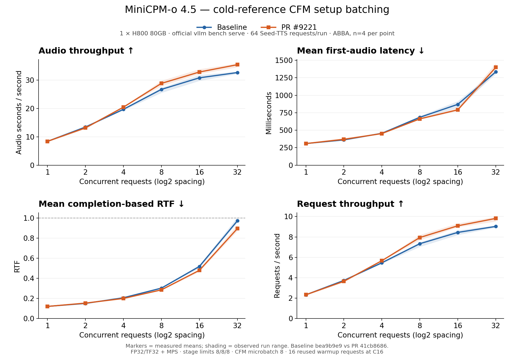

# MiniCPM-o 4.5 cold-reference CFM setup — serving curves

Results supporting https://github.com/vllm-project/vllm-omni/pull/9221.
Measurements collected on 2026-10-21 UTC.

## Comparison

- Baseline: `bea9b9e9ecb980d3cbdbf0ee061a42f325b83e75`.
- PR: `41cb868615e8480e5d75f6b9dfc9732ccac3eddc`.
- One H800 80GB, same physical GPU for every run, MPS in both arms.
- vLLM 0.32.0; PyTorch 2.13.0+cu130; Transformers 5.19.0; datasets 3.6.0.
- Both checkouts use the same external vLLM 0.32 embedding API compatibility
  adjustment: `self.llm.get_input_embeddings(input_ids)` becomes
  `self.llm.embed_input_ids(input_ids)`.
- Unmodified baseline `vllm bench serve --omni --backend openai-chat-omni`
  client and fixed 64-request English Seed-TTS subset for both arms.
- MRV2 turn serving; Thinker/Talker BF16; Code2Wav FP32/TF32.
- Stage max_num_seqs 8/8/8, CFM microbatch 8, graph precapture enabled.
- Stage 0 max_model_len/max_num_batched_tokens 4096, multimodal input limits 0,
  Stage 0/1 KV budgets 4/2 GiB; OMP_NUM_THREADS=8.

## Protocol and interpretation

Fresh server order A1 → B1 → B2 → A2. Each server receives 16 warmup requests
at C16 (reusing the first 16 evaluation requests), followed by C1/C2/C4/C8/C16/C32
in order. At each concurrency, one 64-request run is discarded and the next two
are measured. Each plotted mean therefore uses four measured runs per arm.
This is a new complete six-point sweep, not a combination of separate studies.

Markers are measured means. Bands show the observed min/max of per-run
statistics, not confidence intervals. Lines only connect measured points;
unmeasured concurrency values are not estimated. The log2 x-axis places the
six doubling concurrency levels at equal spacing.

- Audio throughput: official `audio_throughput` (generated audio seconds/s).
- First-audio latency: official `mean_audio_ttfp_ms` (called TTFA in the PR).
- RTF: official `mean_audio_rtf`, completion-based, lower is better.
- Request throughput: official `request_throughput` (requests/s).

WER evaluation is disabled during these timing runs. The separate WER evidence
and original three-point study remain documented in the PR. Concurrency 32 is
client concurrency; the deployment's stage sequence limits remain 8/8/8.

## Files

- `measurements.csv`: all 48 measured run-level records, including result-file
  SHA256, request success counts, chart metrics, p95 first-audio latency,
  mean E2E latency, and generated audio duration.
- `summary.json`: exact means/min/max, revision IDs and measurement protocol.
- `table.md`: readable numeric values underlying the chart.
- `concurrency-performance.png`: the figure embedded in the PR description.

The artifact branch is separate from the implementation branch, keeping the
performance image/data out of the upstream code diff.
