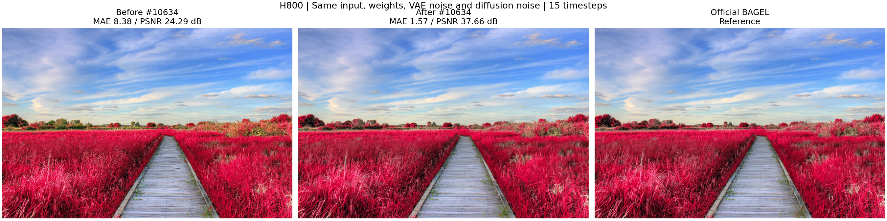

# BAGEL H800 reference comparison

The BAGEL img2img CI sample was run before and after vllm-project/vllm-omni#10634 and with the official BAGEL implementation. The corrected output is substantially closer to the official reference: full-image mean absolute pixel error falls by **81.30%**.

| Compared with official BAGEL, identical noise | Before #10634 | After #10634 |
|---|---:|---:|
| Mean absolute error, RGB channel scale 0–255 (lower is better) | 8.3769 | 1.5669 |
| RMSE, RGB channel scale 0–255 (lower is better) | 15.5669 | 3.3373 |
| PSNR (higher is better) | 24.2868 dB | 37.6629 dB |

Original 1024 × 672 PNGs: [before](before.png), [after](after.png), [official](official.png). The comparison figure places these unmodified output images side by side. [Results, versions, and tensor fingerprints](results.json).

## Revisions

- Before: [714c0c7991675c5bc5623f59a413a8545f4ae105](https://github.com/vllm-project/vllm-omni/commit/714c0c7991675c5bc5623f59a413a8545f4ae105).
- After: [1db21ca892dddf6c8bb3d4e66bb6077366da3426](https://github.com/vllm-project/vllm-omni/commit/1db21ca892dddf6c8bb3d4e66bb6077366da3426), the #10634 merge commit.
- Official: [ByteDance-Seed/BAGEL a2fa77dd8caeefc41e6607ae0ec17408d3f4ee9f](https://github.com/ByteDance-Seed/BAGEL/tree/a2fa77dd8caeefc41e6607ae0ec17408d3f4ee9f).
- Model: `ByteDance-Seed/BAGEL-7B-MoT`, snapshot `5019f57d168e5816e8f3f701b17cc816bb7cf24b`.

## Test conditions

NVIDIA H800 80 GB; the existing advanced-model BAGEL shared-memory connector CI deployment and img2img helper. Input: `2560px-Gfp-wisconsin-madison-the-nature-boardwalk` (2560 × 1669 RGB). Prompt: `Change the grass color to red`.

15 timesteps, seed 52, text CFG 4.0, image CFG 1.5, CFG interval [0.4, 1.0], timestep shift 3.0, global renormalization with minimum 0.0. Output: 1024 × 672. TaylorSeer disabled.

The reference comparison records and supplies identical VAE sampling noise and diffusion initial noise to all three implementations. VAE epsilon is generated on CPU as float32 with seed 53 and shape (1, 16, 84, 128), then converted to the consumed bfloat16 dtype. Diffusion noise is generated on CPU as float32 with seed 52 and shape (2688, 64). Consumed tensor SHA256 hashes match across all three runs. Input RGB hashes also match. Startup dummy inputs are excluded from these hooks.

The official driver uses the frozen upstream model and inferencer, with explicit CUDA input placement following the official evaluation drivers. The hooks capture or substitute only the stated random tensors. Omni uses torch 2.14.0 / vLLM 0.34.0 / transformers 5.22.2; official BAGEL uses torch 2.5.1+cu124 / transformers 4.49.0 / flash-attn 2.7.4.post1.

## Existing CI golden check

Separate before/after runs retained their normal random draws. Both raw runs consumed identical VAE and diffusion noise. The existing CUDA pixel tolerance remains 10.

| Raw output | Old golden | #10681 golden |
|---|---:|---:|
| Before #10634 | 10/10 pass | 5/10 pass |
| After #10634 | 5/10 pass | 10/10 pass |

After #10634, the maximum channel difference from the new golden is 8. The H800 results reproduce the old-golden mismatch and support the #10681 update at the existing tolerance.

This evidence covers the specified 15-timestep img2img CI case. The backport in #10637 carries the upstream fix; the revisions measured here are the main-branch commits listed above.
